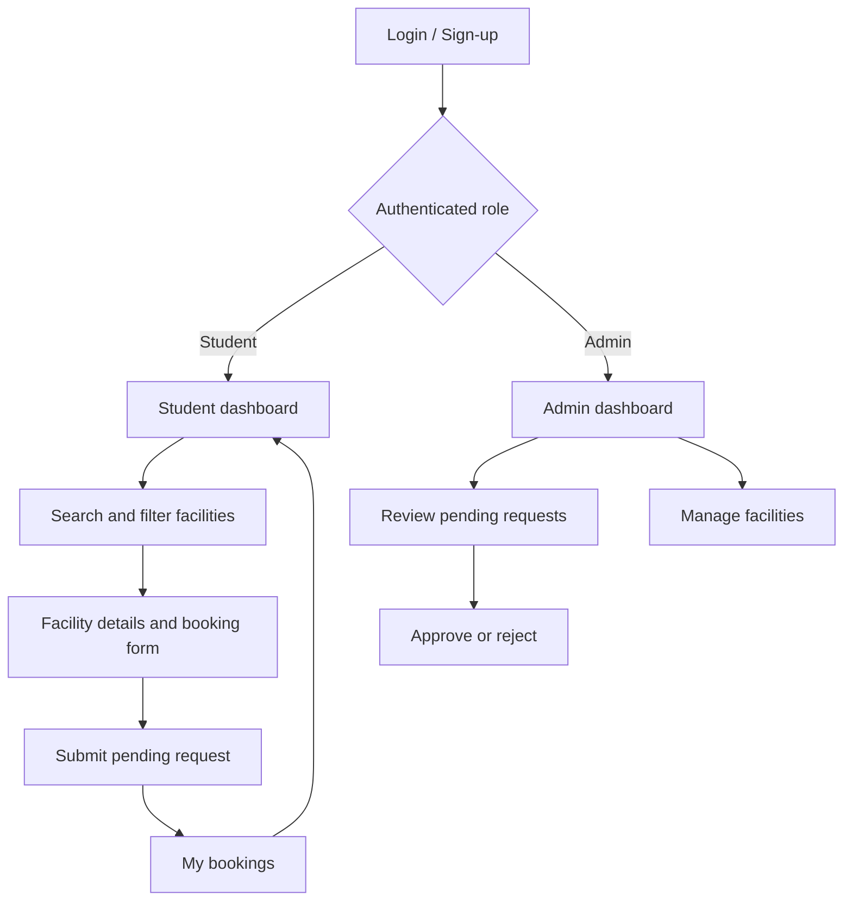

# UI Design

This Day 2 prototype defines the front-end structure for the Smart Campus Facility Booking & Management System. It deliberately uses sample data only. Authentication, API calls, and database persistence start on Day 3.

## Running the prototype

Open `index.html` in a modern browser. The prototype has no build step or external dependency. It includes temporary in-browser interactions so the proposed navigation can be reviewed.

## Wireframes

| Screen | Wireframe | Purpose |
| --- | --- | --- |
| Login and sign-up | [login-signup.svg](wireframes/login-signup.svg) | Sign in existing users or register a new student. |
| Student dashboard | [student-dashboard.svg](wireframes/student-dashboard.svg) | Search and browse facilities before booking. |
| Facility booking | [facility-booking.svg](wireframes/facility-booking.svg) | Review a facility and submit a time-bound request. |
| Admin dashboard | [admin-dashboard.svg](wireframes/admin-dashboard.svg) | Review pending requests and monitor facilities. |

The runnable version of these wireframes is at the project root: `index.html`, `styles.css`, and `app.js`.

## Screen requirements

### 1. Login and sign-up

- Campus email and password fields support sign-in.
- The sign-up view adds a full-name field.
- New registrations are visually labelled as student accounts. Role assignment is never selected in the public form.
- A future implementation must show server-side authentication errors without confirming whether an email exists.

### 2. Student dashboard

- A search field finds facilities by name or location.
- Type and date controls make the facility list scannable.
- Each card shows type, location, capacity, an availability signal, and a single “View & book” action.
- “My bookings” presents the student's existing requests and their status.

### 3. Facility booking

- The left panel confirms the selected facility, location, capacity, and included equipment.
- The booking form collects date, start time, end time, and a purpose.
- The availability hint is only a UI indicator. The server must be the source of truth for conflicts.
- A request becomes `pending`; it is not a confirmed booking until an administrator approves it.

### 4. Admin dashboard

- Top metrics give a quick count of pending requests, facilities, and daily activity.
- A request table provides approve and reject actions.
- A facility list highlights the inventory that an administrator will manage.
- Facility creation and edits are visually represented but intentionally not implemented in the Day 2 prototype.

## Navigation flow

The detailed diagram is available at [navigation-flow.svg](wireframes/navigation-flow.svg).

## Interface principles

- Keep the main student task visible: find a space, select a time, request it.
- Distinguish a submitted request from an approved reservation with clear status labels.
- Use labels and focus states for keyboard-accessible forms.
- Do not rely on colour alone for booking status or availability.
- Keep administrator controls separate from the student experience.
